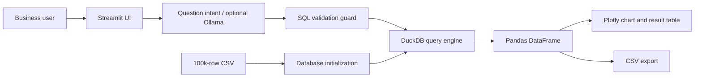

# Architecture

## Components
- **Streamlit:** user interface and interactive demo.
- **Optional Ollama:** local natural-language-to-SQL generation; default built-in intent mapping works without it.
- **SQL guard:** restricts queries to one read-only SELECT/WITH statement against the approved `sales` table.
- **DuckDB:** in-process analytical query engine.
- **Pandas:** query result DataFrame.
- **Plotly:** charts.
- **CSV:** synthetic 100,000-row demo data.

## Security boundaries
The demo guard is a defensive baseline, not a hardened multi-tenant security boundary. Do not expose this app publicly or use it with sensitive data without authentication, authorization, query resource limits, stronger SQL parsing, and infrastructure hardening.
